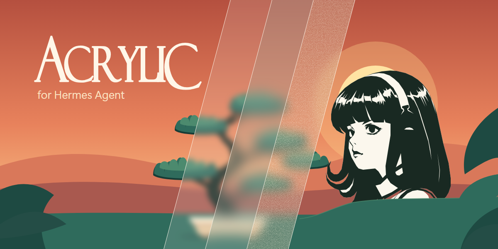
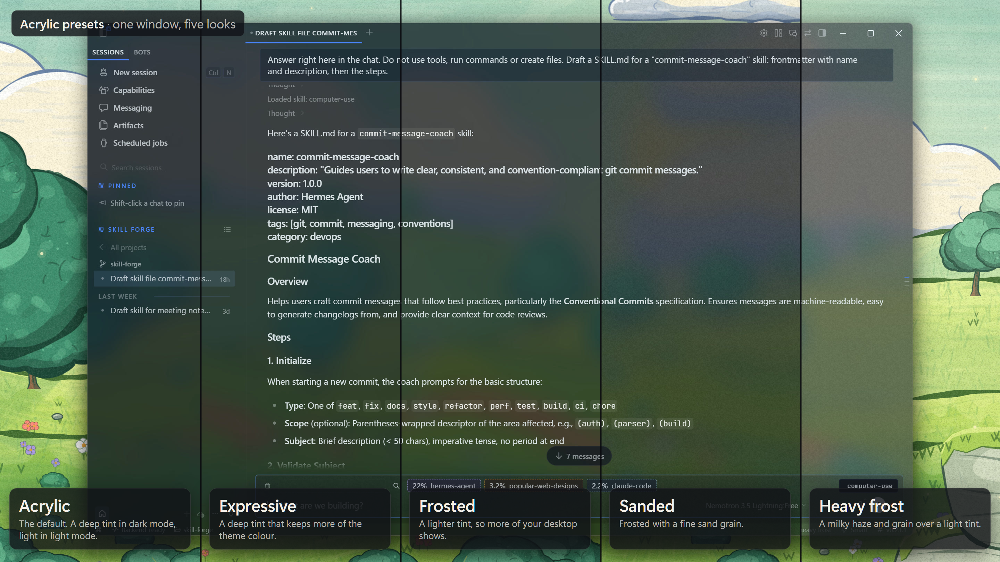
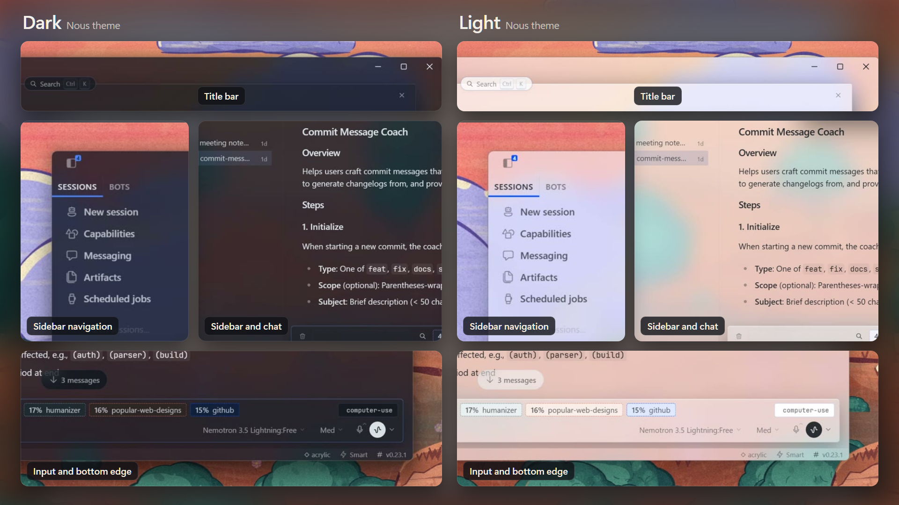

# Acrylic



[](plugin.yaml)
[](https://github.com/NousResearch/hermes-agent/pull/154072)
[](plugin.yaml)
[](LICENSE)

Acrylic glass for Hermes Desktop: a frosted, see-through theme with five presets and your own tint, haze and grain. Tested mostly on Windows 11, where it sits on the system's real acrylic blur. Elsewhere it shows a CSS stand-in.

Plugin only: no build, no native code, no Hermes patches. Everything is CSS plus a small Settings card and settings page, through the plugin SDK.

## See it

One window, five presets: each strip is the same moment with a different preset.



Dark and light: the same parts of the window in both modes.



## What you get

- **The Windows Acrylic theme.** Pick it in Settings → Appearance (or Ctrl+K → **Apply Windows Acrylic Theme**). The look applies only while the theme is selected.
- **Five presets:** **Acrylic** (the default: a light tint in light mode, a deep one in dark mode), **Frosted** (a medium tint, more blur), **Sanded** (Frosted with a fine grain), **Expressive** (a deep tint in both modes) and **Heavy frost** (a light tint under a milky haze, with grain). Pick one in the Acrylic card or with Ctrl+K → **Acrylic preset: …**.
- **Your own glass.** Settings → Plugins → **Acrylic** has sliders for **Tint**, **Frost haze** and **Grain** (off, fine or coarse, and how strong). A preset fills them in; change any of them and the preset becomes **Custom**, which keeps your values until you change them again.
- **Every theme (optional).** Off by default. Turn it on in the Acrylic card or the status-bar chip and the same glass tints whatever theme you use.
- **The Acrylic card** in Settings → Appearance: the theme button, the Every theme switch, the presets, a link to the tint, haze and grain settings, a **Glass settings** button that opens Settings → Appearance, and what to expect on your system.
- **A status-bar chip** showing the current state: `◇ acrylic`, `(no glass)`, `(css)` or `off`.

## Real acrylic needs Glass

The blur of your desktop behind the window comes from Hermes itself: **Settings → Appearance → Window Translucency → Glass**. Acrylic never changes that setting for you; the **Glass settings** button takes you there.

- **Windows 11 22H2 or newer with Glass on:** Windows draws the real acrylic behind the window, and Acrylic tints it with the theme's colours.
- **Glass off, or Linux:** a CSS stand-in over Hermes' Chat Backdrop picture (Settings → Appearance → Chat Backdrop). It frosts that picture, not other windows.
- **When the window is not active**, Windows shows a flat colour instead of acrylic. That is how Windows works.

## How menus and the terminal look

- **Ctrl+K and full-page cards** (Settings, Scheduled jobs, Profiles and the like) are real acrylic under Glass: the app is cut away exactly under them, so Windows' blur of your desktop shows through. Without Glass they blur the page behind them.
- **Menus, the `/` menu, dialogs, toasts and tooltips** get the theme's solid background under Glass, so the chat behind them does not read through. Without Glass they blur the page behind them.
- **The terminal** keeps a solid background in the theme's colour, with a thin outline; the frame and tab strip around it stay glass. Hermes draws the terminal's text with an opaque renderer for sharp text, and a plugin cannot change that.

## Install

From the catalog:

```bash
hermes plugins install acrylic
```

By hand: copy `desktop/plugin.js` into `desktop-plugins/hermes-acrylic/` in your Hermes home (`%LOCALAPPDATA%\hermes` on Windows, `~/.hermes` on macOS and Linux), then Ctrl+K → **Reload desktop plugins**.

Then pick the Windows Acrylic theme and, on Windows 11, turn on Glass.

## Commands (Ctrl+K)

| Command | What it does |
| --- | --- |
| Apply Windows Acrylic Theme | Selects the theme. |
| Acrylic preset: Acrylic / Frosted / Sanded / Expressive / Heavy frost | Switches the preset. |
| Acrylic: tint every theme (on/off) | Turns Every theme on or off. |
| Acrylic: open Settings → Appearance (Glass) | Opens the page where Glass is. |
| Acrylic: clear Chat Backdrop | Turns Hermes' Chat Backdrop off. |

## Limitations

These need hooks Hermes does not offer to plugins yet:

- **A see-through terminal.** The terminal renderer is opaque. Asked for in [NousResearch/hermes-agent#154464](https://github.com/NousResearch/hermes-agent/issues/154464).
- **Real acrylic behind menus.** In a see-through window a CSS blur only sees the page, never the desktop, so menus and dialogs get the theme's solid background instead of a see-through tint. A stable hook for this is asked for in [NousResearch/hermes-agent#154465](https://github.com/NousResearch/hermes-agent/issues/154465).
- **Turning on Glass for you.** The Glass setting is not open to plugins, so Acrylic points you to it. Tracked in [NousResearch/hermes-agent#121896](https://github.com/NousResearch/hermes-agent/issues/121896).

How the layers, the surfaces and the cut-outs work, and how to test them: [docs/how-it-works.md](docs/how-it-works.md).

To remove it, disable the plugin under Capabilities → Plugins; Hermes falls back to its own theme.

## License

MIT. See [LICENSE](LICENSE).
